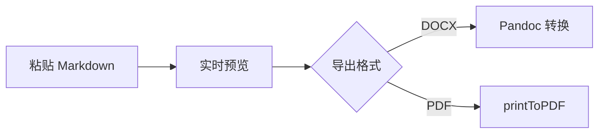

# Markdown 编辑器

从 AI 对话复制 Markdown，实时预览，一键导出 **Word / PDF**。

## 数学公式

行内公式 $E = mc^2$，块级公式：

$$
\int_{-\infty}^{\infty} e^{-x^2}\,dx = \sqrt{\pi}
$$

## 表格

| 格式 | 适用场景 | 说明 |
|---|---|---|
| Markdown | 写作草稿 | 跨平台、纯文本 |
| DOCX | 交付文档 | 可继续编辑 |
| PDF | 归档打印 | 排版稳定 |

## 代码块高亮

```js
const editor = document.getElementById('editor');
editor.addEventListener('input', updatePreview);
```

## Mermaid 流程图


