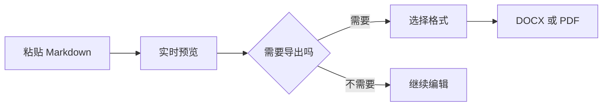
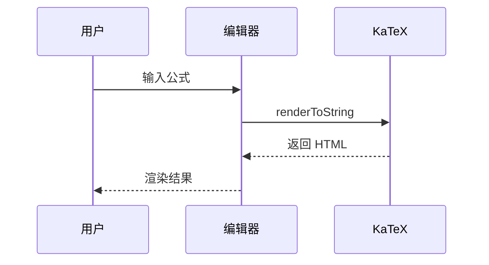

# Markdown 编辑器 · 渲染能力总览

> 这份文档既是**功能演示**，也是**渲染自检样例**：把它拖进编辑器，右侧预览应与下面的预期一致。

## 一、文本与行内格式

普通段落里可以包含 **加粗**、*斜体*、***加粗斜体***、~~删除线~~、`行内代码`，以及链接 [GitHub](https://github.com)。

特殊符号：→ ⇒ ⇐ ≤ ≥ ≠ ≈ ± × ÷ ∑ ∏ ∫ ∂ ∇ ∞ π α β γ Δ Ω ✔ ✘

## 二、数学公式

行内公式：质能方程 $E = mc^2$，欧拉恒等式 $e^{i\pi} + 1 = 0$。

块级公式 —— 一元二次方程求根公式：

$$
x = \frac{-b \pm \sqrt{b^2 - 4ac}}{2a}
$$

高斯积分：

$$
\int_{-\infty}^{+\infty} e^{-x^2}\,dx = \sqrt{\pi}
$$

级数求和：

$$
f(n) = \sum_{k=1}^{n} \frac{1}{k^2} \quad \Rightarrow \quad f(\infty) = \frac{\pi^2}{6}
$$

矩阵乘法：

$$
\begin{pmatrix} a & b \\ c & d \end{pmatrix}
\begin{pmatrix} x \\ y \end{pmatrix}
=
\begin{pmatrix} ax + by \\ cx + dy \end{pmatrix}
$$

## 三、表格

| 功能 | 是否支持 | 说明 |
|:---|:---:|:---|
| 实时预览 | ✅ | 输入即渲染 |
| LaTeX 公式 | ✅ | KaTeX 渲染 |
| Mermaid 图表 | ✅ | 流程图 / 时序图 / 甘特图 |
| 导出 PDF | ✅ | 与预览效果一致 |
| 导出 DOCX | ✅ | 需要安装 Pandoc |

上面三列分别是**左对齐、居中、右对齐**。

## 四、Mermaid 图表

流程图：



时序图：



## 五、代码块高亮

JavaScript：

```js
const editor = document.getElementById('editor');
let timer;

editor.addEventListener('input', () => {
  clearTimeout(timer);
  timer = setTimeout(() => render(editor.value), 200);
});
```

Python：

```python
def perplexity(logits, labels):
    loss = torch.nn.functional.cross_entropy(logits, labels)
    return torch.exp(loss)
```

SQL：

```sql
SELECT file_name, COUNT(*) AS changes
FROM revisions
WHERE created_at >= '2026-01-01'
GROUP BY file_name
ORDER BY changes DESC;
```

## 六、引用与列表

> **提示**：导出 DOCX 需要先安装 Pandoc。
>
> > 嵌套引用同样可以正常显示。

无序列表：

- 一级项目
  - 二级项目
    - 三级项目

有序列表：

1. 新建文件
2. 输入内容
3. 导出文档

任务列表：

- [x] 实时预览
- [x] 公式与图表渲染
- [ ] 离线资源打包（见路线图）

## 七、分隔线

---

## 关于本文件

- **用途**：README 截图素材、渲染回归测试、新用户上手示例
- **位置**：`examples/showcase.md`
- **约定**：如果某一节渲染异常，说明渲染管线出现了回归，欢迎提交 Issue
